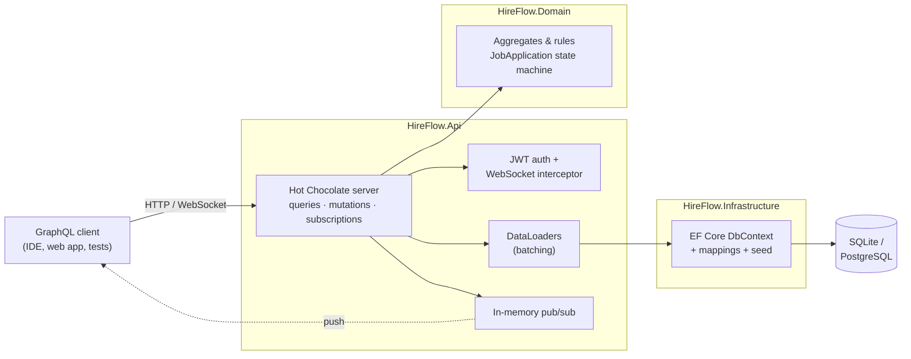
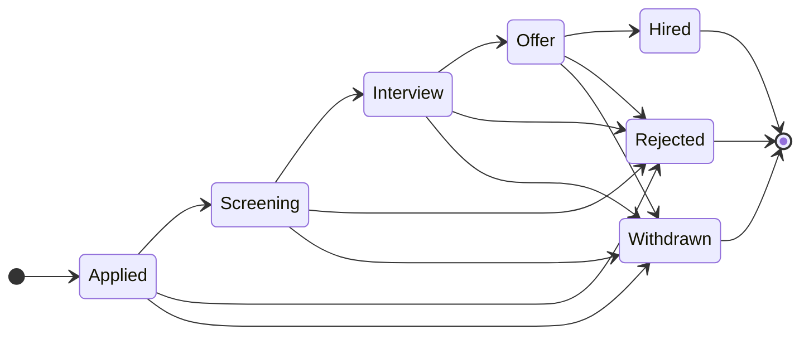
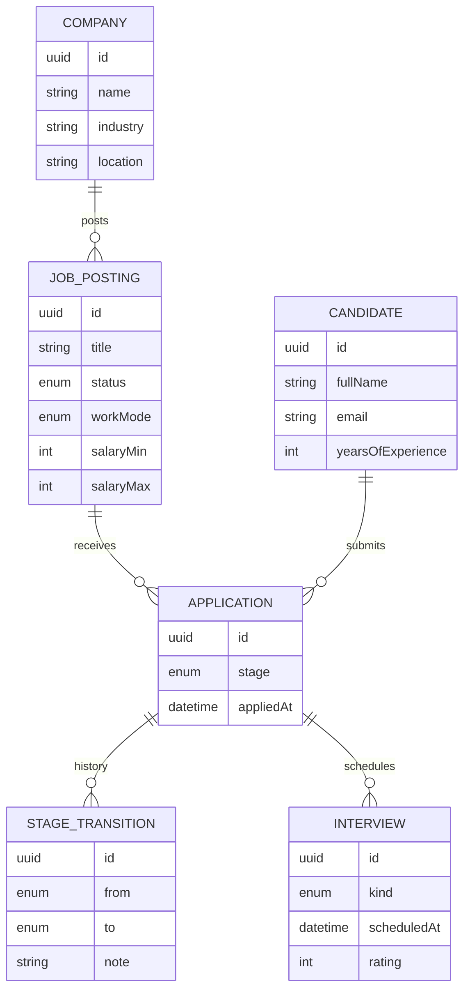

<div align="center">

# 🧭 HireFlow

**A production-style GraphQL API for running a hiring pipeline: companies, job postings, candidates, applications and interviews.**

Built with **.NET 10**, **Hot Chocolate 16** and **EF Core 10**.

[](https://github.com/AutumnTrace/hireflow/actions/workflows/ci.yml)


[](LICENSE)

[Quick start](#-quick-start) · [Features](#-features) · [Architecture](#-architecture) · [Example operations](#-example-operations) · [Design decisions](#-design-decisions)

</div>

---

## ✨ Features

| | |
|---|---|
| 🔎 **Rich querying** | Cursor pagination, filtering and sorting on every list (`where`, `order`, `first/after`, `totalCount`) |
| ⚡ **No N+1 queries** | Every relationship is resolved through batched, source-generated **DataLoaders** |
| 🧱 **Domain-driven core** | The hiring pipeline is an explicit **state machine**; illegal moves are impossible, not just discouraged |
| 🧯 **Errors as data** | Business failures come back as **typed GraphQL errors** (`InvalidStageTransitionError`, `DuplicateApplicationError`, …) through mutation conventions |
| 📡 **Real-time** | **Subscriptions** over WebSockets push pipeline changes to a live board |
| 🔐 **Auth** | JWT bearer auth with role-based `[Authorize]` on fields, mutations *and* WebSocket sessions |
| 📊 **Analytics** | Per-job hiring funnel (`pipeline { total hireRate byStage }`) computed in one grouped SQL query |
| 🗄️ **Two databases** | SQLite for zero-setup local runs, PostgreSQL for Docker/production; CI runs the full suite on **both** |
| 🧪 **Tested** | Domain unit tests, end-to-end GraphQL tests, WebSocket subscription tests and a **schema snapshot** test |
| 🐳 **Ship-ready** | Multi-stage Dockerfile, `docker compose` stack, GitHub Actions CI |

## 🚀 Quick start

### Option A: just .NET (SQLite, nothing else to install)

```bash
git clone https://github.com/AutumnTrace/hireflow.git
cd hireflow
dotnet run --project src/HireFlow.Api --launch-profile http
```

Open **http://localhost:5230/graphql** for the built-in GraphQL IDE. The database is created and seeded with demo data on first run.

### Option B: Docker + PostgreSQL

```bash
docker compose up --build
```

The API is at **http://localhost:8080/graphql**, backed by PostgreSQL 17.

### Get a token

Read operations on the public job board work anonymously. Recruiter features need a JWT. In development, the API can issue one:

```bash
curl -X POST http://localhost:5230/auth/token \
  -H "Content-Type: application/json" \
  -d '{ "name": "Jane Recruiter", "role": "Recruiter" }'
```

Add `Authorization: Bearer <accessToken>` to the IDE's HTTP headers. For subscriptions, send the same value as `Authorization` in the `connection_init` payload.

> [!NOTE]
> `/auth/token` exists only when `Jwt:EnableDevTokens` is `true` (Development and the Docker demo). In production you would plug in a real identity provider. The API only validates standard JWTs.

## 🏗 Architecture



The domain project has **no dependency** on GraphQL or EF Core. It is plain C# with the business rules, so it can be unit-tested in isolation.

### The hiring pipeline

Every application moves through this state machine. It lives in [`ApplicationStageRules`](src/HireFlow.Domain/Applications/ApplicationStage.cs), and the API exposes it as `allowedNextStages` so a UI can render only valid buttons.



Each move is stored as an immutable `StageTransition`, which gives every application a full audit timeline (`history { from to note changedAt }`).

### Data model



## 🧪 Example operations

More ready-to-paste operations are in [`docs/examples.graphql`](docs/examples.graphql), and the full contract is in [`schema.graphql`](schema.graphql).

<details open>
<summary><b>Public job board</b>: filtering, sorting, pagination and a batched relation</summary>

```graphql
query JobBoard {
  jobs(
    first: 10
    where: { workMode: { in: [REMOTE, HYBRID] }, salary: { min: { gte: 40000 } } }
    order: [{ publishedAt: DESC }]
  ) {
    totalCount
    pageInfo { hasNextPage endCursor }
    nodes {
      title
      requiredSkills
      salary { min max currency }
      company { name location }   # one batched SQL query for all companies
    }
  }
}
```
</details>

<details>
<summary><b>Recruiter dashboard</b>: funnel analytics and application timelines (auth)</summary>

```graphql
query RecruiterDashboard {
  jobs(where: { status: { eq: OPEN } }) {
    nodes {
      title
      pipeline { total hireRate byStage { stage count } }
      applications {
        stage
        allowedNextStages
        candidate { fullName headline }
        history { from to note changedAt }
        interviews { kind scheduledAt rating }
      }
    }
  }
}
```
</details>

<details>
<summary><b>Typed errors</b>: what happens when you try to skip the interview</summary>

```graphql
mutation {
  moveApplication(input: { applicationId: "…", stage: HIRED }) {
    jobApplication { stage }
    errors {
      __typename
      ... on InvalidStageTransitionError { message from to allowedStages }
    }
  }
}
```

```json
{
  "data": {
    "moveApplication": {
      "jobApplication": null,
      "errors": [{
        "__typename": "InvalidStageTransitionError",
        "message": "Cannot move an application from Applied to Hired. Allowed: Screening, Rejected, Withdrawn.",
        "from": "APPLIED",
        "to": "HIRED",
        "allowedStages": ["SCREENING", "REJECTED", "WITHDRAWN"]
      }]
    }
  }
}
```
</details>

<details>
<summary><b>Live pipeline board</b>: subscription over WebSockets (auth)</summary>

```graphql
subscription PipelineBoard($jobPostingId: UUID!) {
  onApplicationStageChanged(jobPostingId: $jobPostingId) {
    from
    to
    note
    changedAt
    application { candidate { fullName } }
  }
}
```
</details>

### API surface

| Queries | Mutations | Subscriptions |
|---|---|---|
| `companies`, `company(id)` | `createCompany` | `onApplicationStageChanged(jobPostingId)` |
| `jobs`, `job(id)` | `createJobPosting`, `publishJobPosting`, `closeJobPosting` | `onApplicationSubmitted(jobPostingId)` |
| `candidates`, `candidate(id)` 🔒 | `registerCandidate` | |
| `applications`, `application(id)` 🔒 | `submitApplication`, `moveApplication` | |
| | `scheduleInterview`, `submitInterviewFeedback` | |

🔒 requires authentication · all mutations require the `Recruiter` or `Admin` role

## 🧠 Design decisions

<details>
<summary><b>Why DataLoaders instead of EF <code>Include</code> or projections?</b></summary>

GraphQL clients choose which relations to fetch, so the server can't know upfront what to `Include`. DataLoaders collect every key requested within one execution tick and resolve them with a single `WHERE id IN (...)` query. A page of 50 jobs with their companies costs **2 queries, not 51**. The loaders are generated at compile time by Hot Chocolate's source generator from plain static methods ([`DataLoaders.cs`](src/HireFlow.Api/GraphQL/DataLoaders.cs)).
</details>

<details>
<summary><b>Why are errors part of the schema?</b></summary>

Top-level GraphQL `errors` are untyped strings, which is fine for "you're not logged in" but poor for business rules. Using [mutation conventions](https://chillicream.com/docs/hotchocolate), each mutation declares exactly which domain exceptions it can raise (`[Error<InvalidStageTransitionException>]`). Hot Chocolate turns them into a union of error types with their properties as fields. Clients get exhaustive, typed error handling, and unexpected exceptions still never leak.
</details>

<details>
<summary><b>Why is the state machine in the domain, not the resolver?</b></summary>

So it is impossible to bypass. `JobApplication.Stage` has a private setter, and the only way to change it is `MoveTo()`, which checks the transition table and records history. The same table powers `allowedNextStages`, the error message hints and the unit tests, so the rules live in one place.
</details>

<details>
<summary><b>Why does the WebSocket interceptor validate the JWT itself?</b></summary>

Browsers can't send headers on a WebSocket upgrade, so clients put the token in `connection_init`. ASP.NET Core caches the authentication result of the original upgrade request (which had no token), so re-running the auth middleware doesn't work. [`SocketAuthInterceptor`](src/HireFlow.Api/Auth/SocketAuthInterceptor.cs) validates the token with the *same* `TokenValidationParameters` as the HTTP pipeline and attaches the principal to the socket.
</details>

<details>
<summary><b>Why SQLite and PostgreSQL?</b></summary>

A reviewer should be able to `git clone && dotnet run` with nothing else installed, which SQLite allows. PostgreSQL is the realistic production target. CI runs the entire test suite against both providers (see the matrix in [`ci.yml`](.github/workflows/ci.yml)) to catch provider-specific translation bugs.
</details>

<details>
<summary><b>Other details</b></summary>

- **UUIDv7 keys** (`Guid.CreateVersion7()`): globally unique like GUIDs, but time-ordered, so B-tree indexes stay compact.
- **Enums stored as strings**: the database stays readable, and reordering an enum can't corrupt data.
- **Defence in depth**: unique indexes back up the domain checks (one application per candidate per job, unique emails).
- **Query safety**: max page size of 50, an execution depth limit, and Hot Chocolate's built-in cost analysis guard against expensive queries.
- **Schema snapshot test**: any change to the public contract shows up as a reviewable diff of `schema.graphql`.
</details>

## 📁 Project structure

```
hireflow/
├── src/
│   ├── HireFlow.Domain/            # Entities, value objects, business rules (no framework deps)
│   │   ├── Applications/           # JobApplication aggregate + pipeline state machine
│   │   ├── Candidates/  Companies/  Interviews/  Jobs/
│   │   └── Common/                 # Domain exceptions, guards
│   ├── HireFlow.Infrastructure/    # EF Core DbContext, mappings, provider switch, seed data
│   └── HireFlow.Api/               # ASP.NET Core host
│       ├── Auth/                   # JWT setup, dev token endpoint, WebSocket auth
│       └── GraphQL/                # Queries, mutations, subscriptions, DataLoaders (one folder per feature)
├── tests/HireFlow.Tests/
│   ├── Domain/                     # Pure unit tests for the rules
│   └── Api/                        # End-to-end GraphQL, subscription and schema snapshot tests
├── docs/examples.graphql           # Ready-to-run operations
├── schema.graphql                  # Committed schema snapshot
├── Dockerfile · docker-compose.yml
└── .github/workflows/ci.yml        # Build + test on SQLite & PostgreSQL, Docker image build
```

## ✅ Testing

```bash
dotnet test
```

| Suite | What it covers |
|---|---|
| `Domain/*` | State machine transitions, terminal stages, validation and normalisation rules |
| `Api/GraphQLApiTests` | Boots the real app with `WebApplicationFactory`, then covers auth, filtering, sorting, the full hiring flow and typed errors |
| `Api/SubscriptionTests` | Opens a real `graphql-transport-ws` socket, checks that events are pushed and bad tokens are rejected |
| `Api/SchemaSnapshotTests` | Fails if the schema changes without updating `schema.graphql` (`UPDATE_SCHEMA=1 dotnet test` to accept) |

To run the suite against PostgreSQL locally:

```bash
HIREFLOW_TEST_POSTGRES="Host=localhost;Username=hireflow;Password=hireflow" dotnet test
```

## ⚙️ Configuration

| Key | Default | Description |
|---|---|---|
| `Database:Provider` | `Sqlite` | `Sqlite` or `Postgres` |
| `ConnectionStrings:HireFlow` | `Data Source=hireflow.db` | Connection string for the chosen provider |
| `Database:Seed` | `true` | Load demo data into an empty database |
| `Jwt:SigningKey` | – | HMAC key, at least 32 chars (**required**) |
| `Jwt:Issuer` / `Jwt:Audience` | `hireflow` / `hireflow-api` | Token validation |
| `Jwt:EnableDevTokens` | `false` | Expose `POST /auth/token` (dev/demo only) |

Every key can be set through environment variables, e.g. `Database__Provider=Postgres`.

## 🗺 Roadmap

- [ ] EF Core migrations, replacing `EnsureCreated`
- [ ] Redis-backed subscriptions for multi-instance deployments
- [ ] Global object identification (`node(id:)`) for Relay clients
- [ ] Candidate ↔ job skill matching score
- [ ] OpenTelemetry tracing for resolvers and SQL

## 📄 License

[MIT](LICENSE) © Mina Rotari
